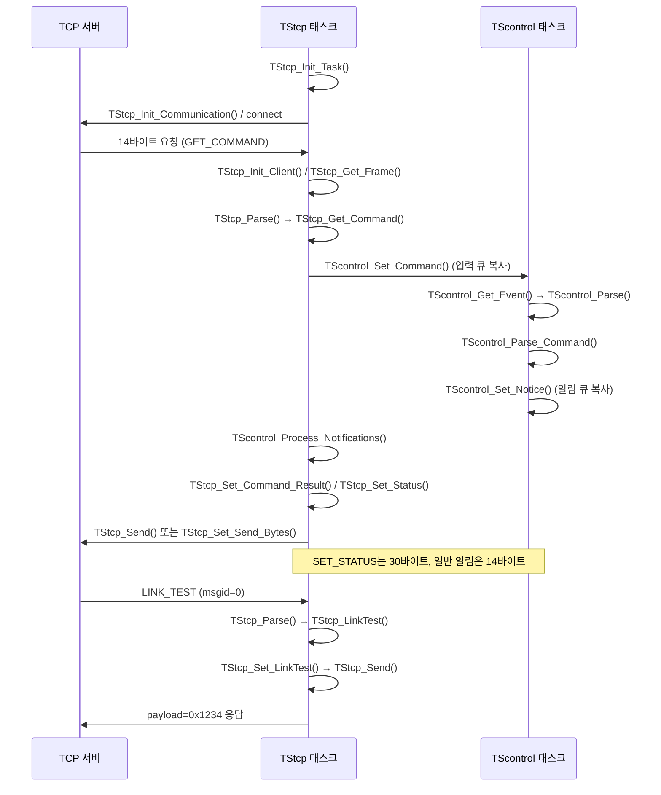
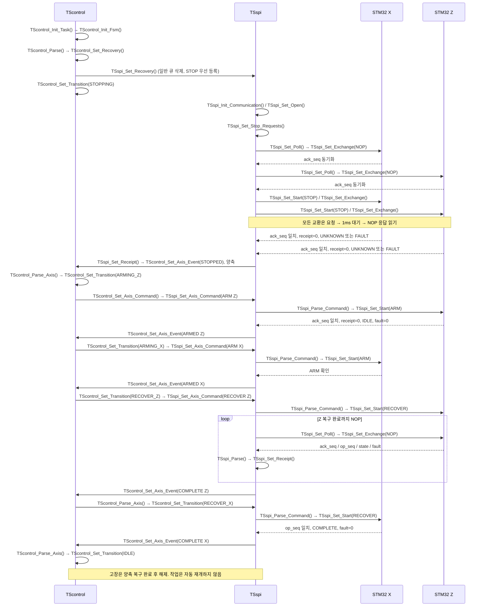
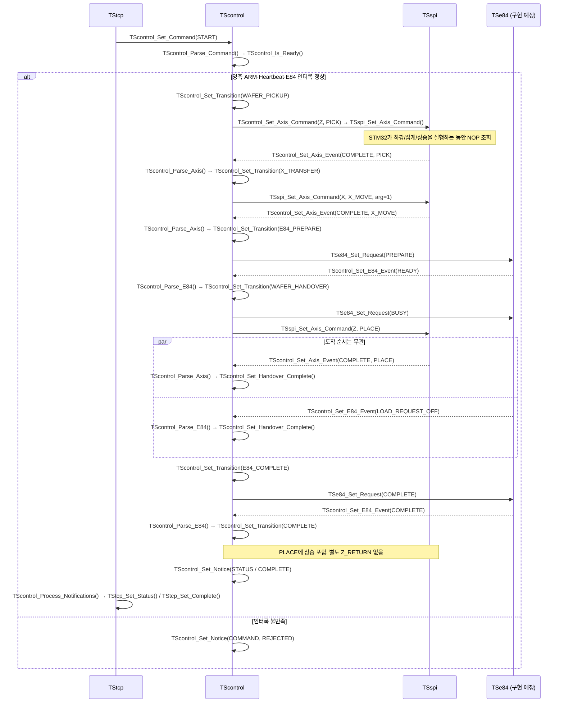
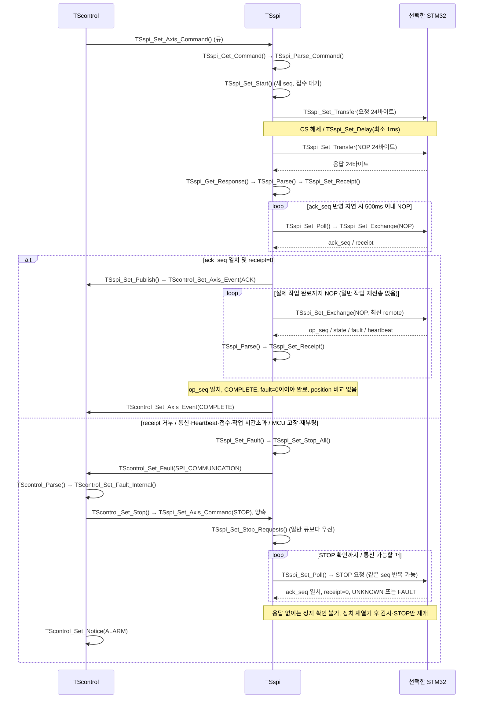

# TCP / 중앙 FSM / SPI v2 시퀀스

현재 [TStcp.c](../app/TStcp.c), [TScontrol.c](../app/TScontrol.c), [TSspi.c](../app/TSspi.c)의 함수명을 표시한다. 상세 값은 [SPI v2 규약](SPI_PROTOCOL.md)을 따른다. E84는 요청·이벤트 인터페이스만 있으며 [TSe84.c](../app/TSe84.c)의 GPIO 동작은 아직 구현되지 않았다.

## TCP 수신과 알림 큐

## 프로세스 시작 / 명시적 복구

처음 실행할 때 아래 복구 이동이 발생할 수 있다. 고장 후에는 GUI의 RECOVER=3 명령이 있어야 이 절차를 시작한다. START=1은 복구 명령이 아니다.

## 중앙 FSM의 정상 반송

## SPI 접수·실제 완료·고장

